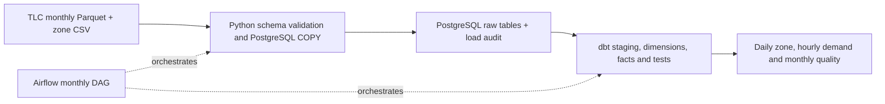

# NYC yellow taxi data pipeline

This pipeline turns public NYC Taxi and Limousine Commission trip records into PostgreSQL reporting tables. A taxi operations analyst can rank pickup zones, compare demand by weekday and hour, calculate average metered fare and distance, and track how many source records fail data-quality rules.

For input checksums, acceptance checks, and a rebuild sequence for an empty repository, see the [replication playbook](docs/replication.md).



## Run locally

Install Docker with Compose v2 or later and use Linux containers. From this directory, copy the sample environment file with `cp .env.example .env` or, on PowerShell, `Copy-Item .env.example .env`. Set a local `PGPASSWORD` value in `.env` before running Compose. The file is ignored by Git.

```bash
docker compose build pipeline
docker compose up -d postgres
docker compose run --rm pipeline load-zones
docker compose run --rm pipeline load-trips --year 2024 --month 1
docker compose run --rm pipeline build
```

Load the remaining two months and refresh reporting:

```bash
docker compose run --rm pipeline load-trips --year 2024 --month 2
docker compose run --rm pipeline load-trips --year 2024 --month 3
docker compose run --rm pipeline build
```

Run the load command again with the same source month to replace it, including when TLC corrects a file. Run `build` after a replacement. Each raw load validates the input and writes audit metadata. For a local file, mount its directory read-only. This example uses a local `data` folder.

```bash
docker compose run --rm -v "./data:/data:ro" pipeline load-trips --year 2024 --month 1 --file /data/yellow_tripdata_2024-01.parquet
```

## Report and inspect

Connect a PostgreSQL client to `localhost` using `POSTGRES_HOST_PORT`, `PGUSER`, `PGDATABASE`, and `PGPASSWORD` from `.env`. Run the [example SQL](queries/operations.sql) for the most-used pickup zones, weekday and hourly demand, weighted averages for distance and metered fare, and monthly data-quality rates. The [data dictionary](docs/data.md) defines each row, metric, and quality rule. The [design notes](docs/design.md) explain month replacement and how to interpret the load history.

## Automate with Airflow

```bash
docker compose --profile airflow up -d --build airflow
docker compose logs -f airflow
```

Open the [Airflow UI](http://localhost:8080), or use the port you set in `.env`. Sign in as `admin` with the generated password in the standalone startup log. Unpause `nyc_taxi_monthly` to run it. On **Trigger DAG**, set the `source_month` parameter to `2024-01` and repeat for February and March as needed. Unpausing also enables scheduled runs. A missing upstream file fails the trip task and Airflow retries it. See the [design notes](docs/design.md) for the schedule and recovery steps.

## Tests and run evidence

The Python tests exercise schema and download errors, transactional recovery, and month replacement. From a Python 3.12 environment, install the test dependencies and set the connection string to an instance on which the test role can create and drop test databases.

```bash
python -m pip install -r requirements.txt 'pytest>=7.4,<9'
export PYTHONPATH=src
export TEST_POSTGRES_DSN='host=127.0.0.1 port=5432 dbname=postgres user=taxi password=your-local-password'
python -m pytest -q
```

In PowerShell, set the same environment variables with `$env:PYTHONPATH='src'` and `$env:TEST_POSTGRES_DSN='…'`. Without the DSN, pytest runs the offline cases and skips the database cases. dbt runs structural and business assertions as part of `build`. See the [verification record](docs/evidence.md) for commands, observed timings, counts, and recovery results.

`docker compose down` stops the services and preserves database data in its named volume.

### Run the CLI with an existing PostgreSQL server

With Python 3.12 and a PostgreSQL database where your role can create schemas, install `requirements.txt` and set `PGHOST`, `PGPORT`, `PGDATABASE`, `PGUSER`, `PGPASSWORD`, and `PYTHONPATH=src` in your shell. From this directory, run the same commands using `python -m taxi_pipeline` in place of `docker compose run --rm pipeline`. This path runs ingestion and dbt directly.

## Sources

- [NYC TLC trip records, data dictionaries and zone lookup](https://www.nyc.gov/site/tlc/about/tlc-trip-record-data.page)
- [NYC TLC yellow trip data dictionary](https://www.nyc.gov/assets/tlc/downloads/pdf/data_dictionary_trip_records_yellow.pdf)
- [dbt data tests](https://docs.getdbt.com/docs/build/data-tests)
- [Apache Airflow DAG documentation](https://airflow.apache.org/docs/apache-airflow/stable/core-concepts/dags.html)
